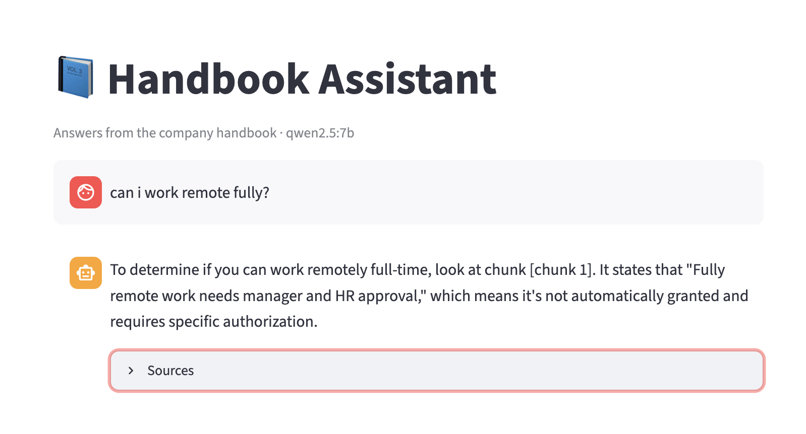

# 📘 Handbook Assistant

A local, private Q&A chatbot that answers questions about a company handbook, with citations, built from scratch with RAG (retrieval-augmented generation). It runs entirely on your machine with [Ollama](https://ollama.com): no API keys and no data leaving your laptop.



## What it does
- Splits the handbook into chunks by section and embeds them with `nomic-embed-text`
- Finds the 2 most relevant chunks for each question using cosine similarity
- Answers with `qwen2.5:7b`, cites its source chunk, and says "I don't know" when the handbook doesn't cover the question
- Streams answers into a Streamlit chat UI, with a **Sources** panel showing the exact text used

## Run it
```bash
ollama pull qwen2.5:7b
ollama pull nomic-embed-text
python -m venv .venv && source .venv/bin/activate
pip install -r requirements.txt
streamlit run app.py        # opens http://localhost:8501
python eval.py qwen2.5:7b   # run the eval suite
```

## Evaluation
`eval.py` runs 15 test questions and scores three things separately, so a failure points to its cause:

| Check | What it tests | Score |
|---|---|---|
| Retrieval | Was the right chunk in the top 2? | 13/13 |
| Answer | Does the answer contain the key fact (or "I don't know" for trap questions)? | 15/15 |
| Citation | Did it cite the chunk the fact came from? | 13/13 |

The tests include paraphrases ("travel expenses" vs. "reimbursements"), questions that need inference ("fly to Delhi" means a domestic flight), and trap questions the handbook can't answer (dress code, maternity leave).

## What I learned debugging it
- **Separate retrieval failures from generation failures.** Most of my bugs were generation: the right text was retrieved, but the model reasoned or cited badly.
- **Sometimes the data is the bug.** The model called Delhi "international" because the handbook never said where the company is. Adding one line to the data fixed it, with no prompt change needed.
- **Models copy examples.** A prompt saying "cite like [chunk 3]" made the model cite chunk 3 even for the wrong text. A neutral `[chunk N]` placeholder fixed it.
- **More context isn't free.** Raising k from 2 to 3 added confusion without improving answers.
- **Labels can collide with content.** The WFH section says "3 days a week", and the model mixed that 3 up with the chunk number. Wrapping chunks in `<chunk id=N>…</chunk id=N>` tags solved it.
- **Graders have bugs too.** My citation regex missed formats like `chunk [4]` and `chunk id=1`, and my checks were stricter than they needed to be.
- **Evals only test the code they actually run.** At one point the app had a fix that `eval.py` didn't, so the scores didn't change.

## How I got here
This project was the capstone of a 6-week, learn-by-building plan:

| File | Week | Concept |
|---|---|---|
| `extract.py` | 1 | Prompting and structured JSON output |
| `embed_demo.py`, `search.py` | 2 | Embeddings and semantic search |
| `rag.py`, `chunk_rag.py` | 3 | RAG, citations, and chunking |
| `agent.py` | 4 | Tool calling and an agent loop |
| `eval.py` | 5 | Evals |
| `app.py` | 6 | Chat UI |

## Limitations
- It needs Ollama running locally, so it can't be hosted on free platforms as-is.
- The handbook is a small 5-section sample, and there's no reranking or conversation memory between questions yet.
